# Alerts and navigation UI proposal: 480×480 round and 1280×800

Status: proposal, 2026-11-04. A first alert balloon is built; see
[Implemented, and the tech debt it leaves](#implemented-and-the-tech-debt-it-leaves). Everything
else here is not implemented. Owner: xiaprojects.

**Question this answers:** how should the RB-01 HMI catch the pilot's attention according to
the type of alert, and how should the pilot move between screens, both by touch and with an
external keypad, on the 480×480 round panel and the 1280×800 panel?

Statements about RB-01 were checked on this working tree, on the running HMI where the text
says so. The mockups are the real HMI with the proposed overlay injected at exact pixel size,
replaying the sample flight, so plate contents are real and alert text is sample text. The round
panel is shown masked to its circle. Regenerate them with
[`alerts-navigation-ui/mockups.py`](alerts-navigation-ui/mockups.py).

## The proposal in brief

**Alerts**

1. Every event gets one of four levels: **WARNING**, **CAUTION**, **ADVISORY** or **LOG**. The
   level sets the colour, size, sound and duration, and it no longer depends on the language.
2. The popup rises from the bottom edge, so the centre of the instrument stays visible. Every
   popup closes by itself after 10 s.
3. **Closing the popup does not end the alert.** An unacknowledged WARNING or CAUTION keeps
   flashing on an annunciator, then stays solid until the condition clears. This is not built yet:
   it is tech debt TD1.
4. Touching the popup or pressing the knob acknowledges it. The screen never changes by itself.

**Navigation**

5. Both displays offer the same eight commands in the same order: a soft bar along the bottom at
   1280×800, and a ring around the centre on the round panel.
6. Touch, keypad and voice all go through the existing `key` event, so each command has one code
   path and the keypad needs no second implementation.

| 480×480 round | 1280×800, both side panels open |
|---|---|
| 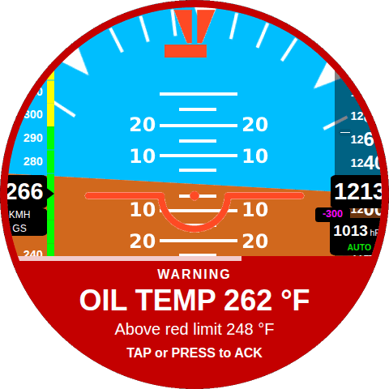 | 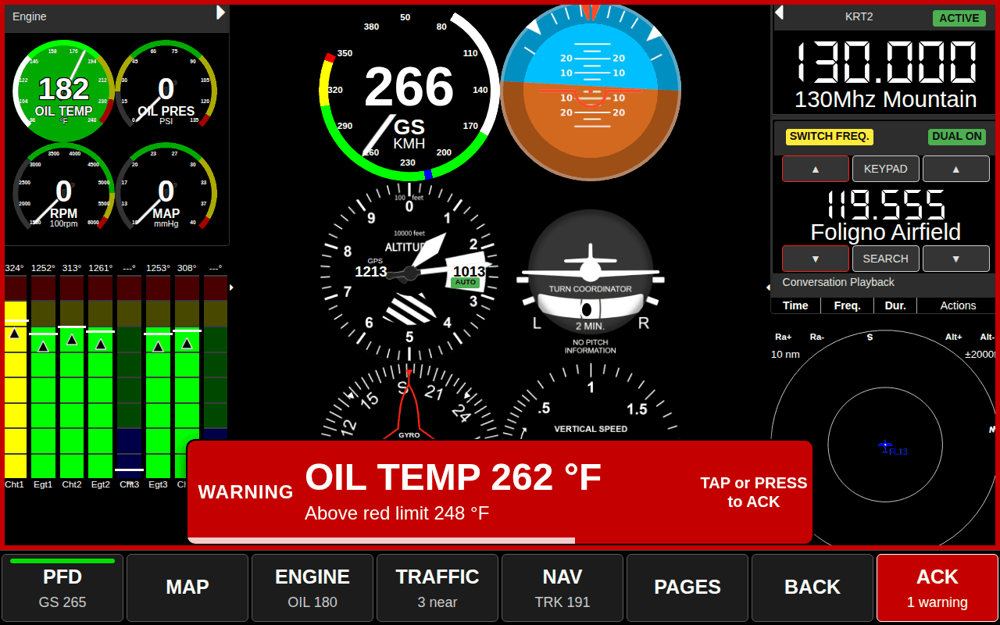 |

## Implemented, and the tech debt it leaves

Decided by xiaprojects and built on 2026-11-04. Where this section and the rest of the proposal
disagree, this section is what the code does.

| | Implemented |
|---|---|
| Duration | Every alert closes by itself after 10 s, whatever its severity |
| Text | One line: the alert's title, or the mapping's text if it has none |
| Colours | `danger` red, `warning` amber, every other alert white with a black font |
| 480×480, round or square | A cap on the bottom edge, 132 px high, and a 9 px ring around the screen in the same colour |
| Bigger panels | A rounded rectangle up to 800 px wide, centred, with its centre at 3/4 of the height |
| Click | Hides the balloon at once. See TD2. |
| Several at once | One balloon. A new alert replaces it unless the new one is less severe. See TD3. |
| Long titles | The font shrinks to 18 px, then an ellipsis cuts the line. See TD5. |
| Alert state, 2026-11-05 | Part of Phase 2, for the engine rules only: `Id` (raise time as `HHMMSScc`), `TimestampEnd`, `Active`, `ActiveSeconds`. `Id` replaces the `Ident` of Phase 2. The Alerts list shows the state. The display replays an alert that comes back after 60 s inactive. `Acked`, hysteresis and trimming the list are still open. See RB-HLR-ALR-270 to 330. |

| Warning, round panel | Caution, round panel | Any other alert, round panel |
|---|---|---|
| 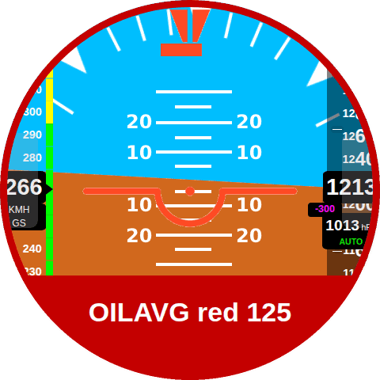 | 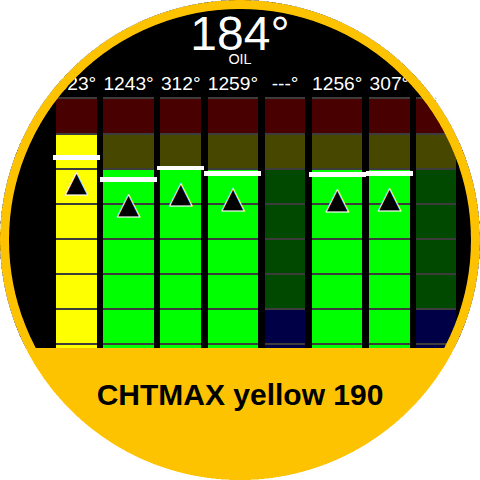 | 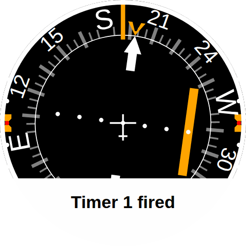 |

| Warning, 1280×800 | Any other alert, 1280×800 |
|---|---|
| 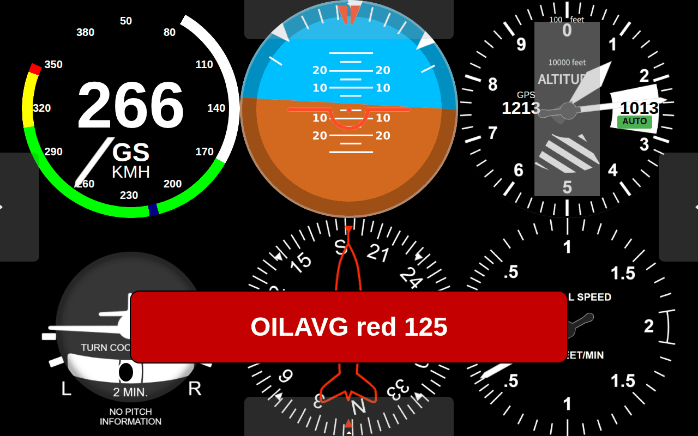 | 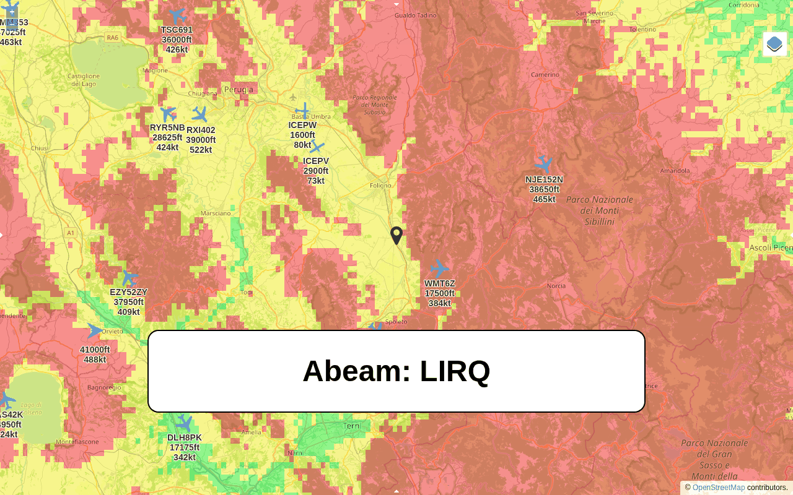 |

The code is in `services/servicealerts.js` and `css/alerts.css`, with the guard corrected in
`js/main.js` (A1), and is tested by `test/display/test_alerts.py`. The service builds the balloon
inside the `#alertsModal` that `index.html` and `simulator.html` both already have, so neither
page changed.

### Tech debt

| # | Debt | Effect today | Done when |
|---|---|---|---|
| TD1 | **The status condition is not kept until the error has ended.** | After 10 s nothing on the screen shows that the condition still exists. A pilot who was looking outside finds it only on `#/alerts`. RB-HLR-ALR-230 stays open because of this. | An annunciator holds the alert until the condition clears ([3.2](#32-one-alerts-life), [3.4](#34-after-the-popup-closes)). Needs the daemon to report clearing (A6). |
| TD2 | **A click only hides the balloon.** This behaviour will change. | Nothing is recorded, so it is not an acknowledgement. Other displays keep their balloon. There is no 500 ms guard, so a tap meant for the plate can hide an unread alert. | Replaced by acknowledgement ([3.2](#32-one-alerts-life)), shared between displays. |
| TD3 | There is no queue. | An alert that arrives while a more severe balloon is showing is never shown as a balloon, only listed. Two same-severity alerts in one burst leave only the last on screen. | The rules of [3.5](#35-several-alerts-at-once). |
| TD4 | The keypad cannot hide a balloon. | The knob pilot waits out the 10 s. | Press acknowledges ([4.4](#44-external-keypad)). |
| TD5 | The text is the daemon's title. | Engine alerts read `OILAVG red 125`: the rule's name, in °C whatever the pilot's unit (A7). System failures are sentences, cut short on the round panel. | Label, value and unit in the alert (phase 2). |
| TD6 | Severity is still the mapping's `Icon`. | The balloon falls back to `en-US` when a language has no row, but the `#/alerts` list does not (A4), so the two can disagree on an Italian display. | `alertsPolicy.json` (phase 1). |

## 1. What exists today

### Alerts

| # | Finding | How it was checked |
|---|---|---|
| A1 | **Fixed 2026-11-04.** **`AlertsService` is never created.** In `js/main.js` `MainCtrl`, the block that creates it is guarded on `$scope.keypad`, which an earlier block has just set. Nothing opens the `/alerts` socket, so no alert reaches the display live and the browser sound path is dead whatever `Display_Audio_Alerts_Enabled` says. | Running HMI at both sizes: `pushAlert`, `alarmIsLit` and `alertsSocket` are all undefined. Created by hand, the socket opens and `pushAlert` runs with no JS error. |
| A2 | RB-HLR-ALR-230 understates this: it assumes the service runs and only the flag is unread. | Read against A1. |
| A3 | The list is the only place to see an alert. At 1280×800 `#/alerts` is page 14 of 19 in the carousel. At 480×480 it is not in `navigationSortSquare`, and on a page outside the list any key sends the pilot to `#/`. | Running HMI: TAP on `#/alerts` moved to `#/`. |
| A4 | Severity lives in the per-language rows: the `Icon` field is both picture and colour. In this working tree `it-IT` has 4 rows and `en-US` has 17, so an Italian display shows a red engine alert with the grey `info` default. | `web/settings/alertsMapping.json`, `generateAlertRow()`. |
| A5 | Two rows are inconsistent. `EVENT_TYPE_RADIO_COMMAND_NOT_OK` has the `info` icon and the `danger` sound. `EVENT_TYPE_GPS_NOT_FIXED` has a row but no Go constant, so nothing raises it. | `alertsMapping.json`, `main/alerts.go`. |
| A6 | An alert has no identity or state: only `Type`, `Title`, `Timestamp`. The daemon cannot say an alert has cleared; RB-HLR-ALR-160 records that 13 of 15 failure identifiers latch. An engine rule returning to green raises nothing. | `main/alerts.go`, `main/ems.go`. |
| A7 | Engine alert titles are raw and in the rule's unit, for example `OILAVG red 125`, while the gauge beside it may read °F. | `validateRules()` in `main/ems.go`. |
| A8 | A rule that goes red, green, then red again within 5 minutes alerts once: `EMS_RULE_ALERT_INTERVAL` blocks the second. | `validateRules()`. |
| A9 | Both sound paths are off by default (RB-HLR-ALR-190). The kiosk launch is not in this repository, so its autoplay policy cannot be checked here. | `main/gen_gdl90.go`, grep of `image_build/` and `scripts/`. |

### Navigation

| # | Finding | How it was checked |
|---|---|---|
| N1 | **The 480×480 panel is round.** `css/style.css` and `css/EMSEGT.css` say so, and detect it with `@container (aspect-ratio = 1) and (width < 512px)`. Corners do not exist, so nothing can be placed there. | Source. |
| N2 | At 480×480 the only touch navigation is the east and west FABs: 48×120 px (about 7×18 mm), cut by the circle, one page at a time through 20 pages. They fade to invisible after 10 s. | Running HMI, exact viewport. |
| N3 | At 480×480 the top and bottom bars cannot be opened, because the north and south FABs need `innerHeight > 480`. | Running HMI: `fabNorthEnabled` and `fabSouthEnabled` are false. |
| N4 | At 1280×800 the bars are off by default, and their tiles are 45–93 × 46 px. | Running HMI. They do reserve their space, so that behaviour is worth keeping. |
| N5 | The daemon sends key hold events, but the `keypadHold` listener is empty. | `main/keypad.go`, `services/servicekeypad.js`. |
| N6 | A key's name depends on the path. The Go path reports `A`, the browser reports `a`, and `keypad.json` binds `A` to `#/` but `a` to `SwipeLeft`. Volume and mute keys have empty names in keylogger, so they only work through the browser path. | keylogger `keymapper.go`, `keypad.json`. |
| N7 | With `Keypad_Enabled` on and the keypad plugged into the Pi running the kiosk, one press may arrive by both paths. **Not tested on hardware.** | Read from the code only. |
| N8 | `timers`, `radio`, `switchboard`, `autopilot` and `airfields` have controls outside the circle on the round panel. This is older than this proposal and is not solved by it. | Running HMI: `Display.controls()`. |

### What can be reused

- `fabClick()` already turns a touch into a `key` event, so touch and keypad share a path.
- `<div id="alertsModal">` is an empty mount point in `index.html`, placed above the app.
- A probe with `sixpack`, `ems` and `synthview` showed plates reflow correctly when the app area
  shrinks to 1280×704.
- `POST /sim/push/alerts` in `test/display/rbserver.py` can drive popups in tests.

## 2. What competitors and guidance do

| Product | Attention | Acknowledge | After acknowledge | Controls | Source quality |
|---|---|---|---|---|---|
| **Garmin G3X Touch** | CAS window on the PFD: red, yellow, white. Optional external lamps. A terrain pop-up appears when the terrain page is not showing. On GDU 450/470 in split screen the CAS window is hidden and a symbol stands in for it. | Touch the message, BACK key, or an optional discrete input | Not stated in the passages read | Touch, knobs, BACK and MENU keys | Pilot's Guide Rev. Y |
| **Dynon SkyView HDX** | Message Notification Area above button 8 flashes. Engine gauges flash. Audio, optional external light. | Open the Message Window; viewing it is the acknowledgement | **Solid in the alert's colour while the condition persists.** Synchronised across displays. | 8 bezel buttons with contextual on-screen labels, 2 knobs, touch | Pilot's Guide Rev. Q |
| **Garmin GI 275 (EIS)** | Flashing annunciation at the bottom. Highest priority shown when several are active. | Press the inner knob or touch the annunciation | Stops flashing, stays until normal | Touch, knob | Manual page |
| **MGL iEFIS** | Alarm light and audio | External button or digital input | Audio stops, light stays while the condition exists. One owner had to acknowledge each of two displays. | Not confirmed | Forum posts and firmware notes, read as search excerpts |
| **Kanardia Nesis III** | Per-alarm choice of text, beep or voice, or disabled. Some alarms only apply with the engine running. | Not confirmed | Not confirmed | Knob | Search excerpts of a third-party manual copy |

What the guidance says. These are design references, not a compliance claim, and AC 25.1322-1 is
for transport aircraft:

- **AC 23.1311-1C:** red for warnings needing immediate recognition, amber for cautions, white or
  another unique colour for advisories, green for safe (§22.7). Abnormal indications should be
  unmistakable, using shape, size, colour, flashing or boxing (§18.3). A prioritisation scheme
  should keep essential information available (§18.4).
- **AC 25.1322-1:** a master visual alert stays on until cancelled or until the condition ends,
  then resets for the next fault (App. 1). If a message is cleared while the condition exists,
  the pilot must be able to recall it (§9). Remove the alert when the condition ends. Master aural
  warnings repeat until acknowledged or cleared. All flashing should be synchronised.
- **AC 20-175:** make the active areas of a touch screen clear and keep functions in a consistent
  place (§3-2). Provide hand stabilisation for use in turbulence (§2-10). A touch surface gives
  little tactile feedback (§3-5).
- **Target size:** Avsar, Fischer and Rodden (2015) recommend about 20 mm for fixed displays and
  safety-critical tasks, and 15 mm for non-critical EFB use, with no gain above 20 mm. Only the
  abstract was available.

What this proposal takes from them:

- **Dynon's flashing-then-solid annunciator**, because it separates "seen" from "gone".
- **GI 275's single press or touch to acknowledge**, because it works with a gloved hand and a knob.
- **G3X's pop-up that is itself the touch target**, instead of a small close button.
- **Dynon's fixed row of labelled keys above physical keys**, and its acknowledgement synchronised
  across displays. The MGL owner's report shows the cost of not doing that.

## 3. Alerts

### 3.1 Levels

| | WARNING | CAUTION | ADVISORY | LOG |
|---|---|---|---|---|
| Meaning | Act now | Be aware, act soon | For information | Record only |
| Popup closes after | **10 s** | **10 s** | **10 s** | No popup |
| Colours | White on red `#c40000` (6.3:1) | Black on amber `#ffc400` (13:1) | White on `#10202e`, white border | |
| Word on popup | WARNING | CAUTION | None | |
| After the popup | Flashes until acknowledged, solid until cleared | Same, in amber | List only | List only |
| Sound | Repeats every 10 s until acknowledged or cleared | Once | Once, short | None |

Level is shown by the word and the size as well as the colour, so it survives a dim panel and
colour-blind pilots. The repeat period suits today's sounds, the longest being 5.4 s.

Proposed level for each event. Levels are a judgement for review against FHA-ALR-1 and FHA-SYS-3.

| Event (type) | Today's icon | Proposed | Ends when | Why |
|---|---|---|---|---|
| `EMS_RULE_RED` (15) | danger | WARNING | Rule leaves red | |
| `EMS_GENERIC_FAILURE` (13) | danger | WARNING | Failure clears | |
| `SYSTEM_DANGER_BAROMETER` (4) | danger | WARNING | Identifier clears | FHA: the altitude is the quantity least likely to be noticed frozen |
| `SYSTEM_DANGER` (3) | danger | WARNING | Identifier clears | Attitude and airspeed failures land here until RB-HLR-ALR-150 is fixed |
| `EMS_RULE_YELLOW` (14) | warning | CAUTION | Rule leaves yellow | |
| `SYSTEM_DANGER_SDR` (5) | danger | CAUTION | Identifier clears | Downgraded: traffic is advisory (A6 in the FHA) |
| `SYSTEM_DANGER_SETTINGS` (6) | danger | CAUTION | Identifier clears | Downgraded: no effect on the flight in progress |
| `RADIO_COMMAND_NOT_OK` (12) | info, `danger` sound | CAUTION | Acknowledged | Fixes A5 |
| `AUTOPILOT_DISENGAGE` (9) | info | CAUTION | Acknowledged | The daemon cannot tell a pilot disconnect from an automatic one |
| `GPS_NOT_FIXED` (16) | danger | CAUTION | Fix returns | Nothing raises it yet |
| `UNKOWN_WARNING` (0) | warning | CAUTION | Acknowledged | |
| `TIMER` (2) | info | ADVISORY | Popup closes | |
| `AUTOPILOT_ENGAGE`, `ABEAM`, `GOTO` (8, 10, 11) | info | ADVISORY | Popup closes | |
| `UNKOWN_INFO` (1) | info | ADVISORY | Popup closes | |
| `STARTUP_INFO` (7) | info | LOG | | It fires on every boot, when no one needs a popup |
| Display link lost (new, raised by the display) | | WARNING | Socket returns | A dead daemon cannot send its own alert. Raise it 3 s after the socket drops. |

The agreed next features use the same levels (`docs/product/competitor-features.md`): terrain
warnings as WARNING, and voice callouts as LOG with a sound, since a spoken altitude needs no
popup. Traffic alerts do not exist yet; the alarm code in `plates/js/radar.js` is commented out.

### 3.2 One alert's life

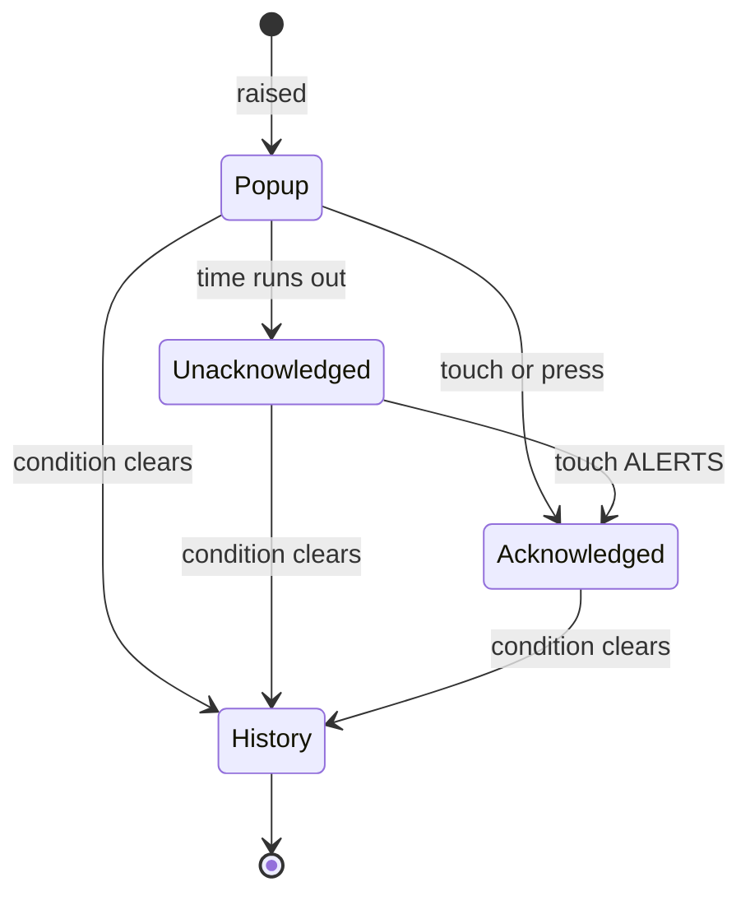

- **Popup:** the sound plays and the countdown bar runs out. On the round panel the ring flashes.
- **Unacknowledged:** the annunciator flashes and a WARNING's tone repeats.
- **Acknowledged:** the flashing and tone stop, and the annunciator stays solid.
- **History:** the annunciator clears, and the alert stays in the list.

Rules:

- **Acknowledging never clears anything.** A mistaken press costs only the flashing.
- A popup whose condition clears at once stays 3 s, so that it can be read.
- Touches and key presses are ignored for the first 500 ms of a popup, so a tap meant for the plate
  beneath cannot acknowledge an alert no one has read.
- The popup is one target with no small close button.
- **The screen is never changed by an alert.** The `newUrl` argument of `pushAlert()` stays unused:
  the pilot may be in the middle of something on the map. A list row can open the source plate.
- Events with no lasting condition, such as a timer, skip the annunciator and go to history.

### 3.3 Popups on each display

Both displays use the same rule: alerts rise from the bottom edge, directly above the place where
the annunciator lives, so the eye and finger go to one area. On every plate the instrument's
centre is the most important area and the lower edge the least, which rules out a centred dialog.

| Level | 480×480 round | 1280×800 |
|---|---|---|
| WARNING | Bottom cap, top at y=316, 164 px high. Ring 9 px. | 800×132, centred, 8 px above the bar. Frame 6 px around the plate area. |
| CAUTION | Bottom cap, top at y=348, 132 px high. Ring 9 px. | 800×112, same position. |
| ADVISORY | Pill 300×64 at (90, 352). | 560×72, centred, same bottom edge. |

On the round panel, text must fit the circle at its lowest line, which is why the text block
narrows towards the bottom. Every level leaves at least the top 316 px on screen.

| CAUTION | ADVISORY | After the popup: unacknowledged |
|---|---|---|
| 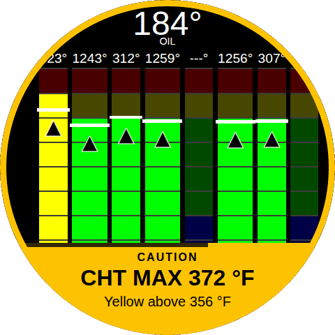 | 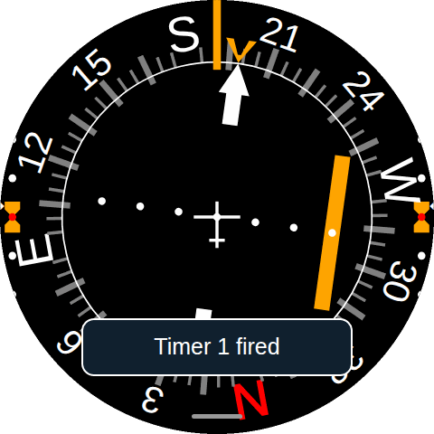 | 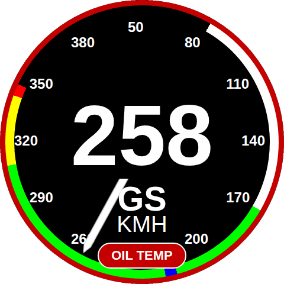 |

| CAUTION, burst of three | ADVISORY |
|---|---|
| 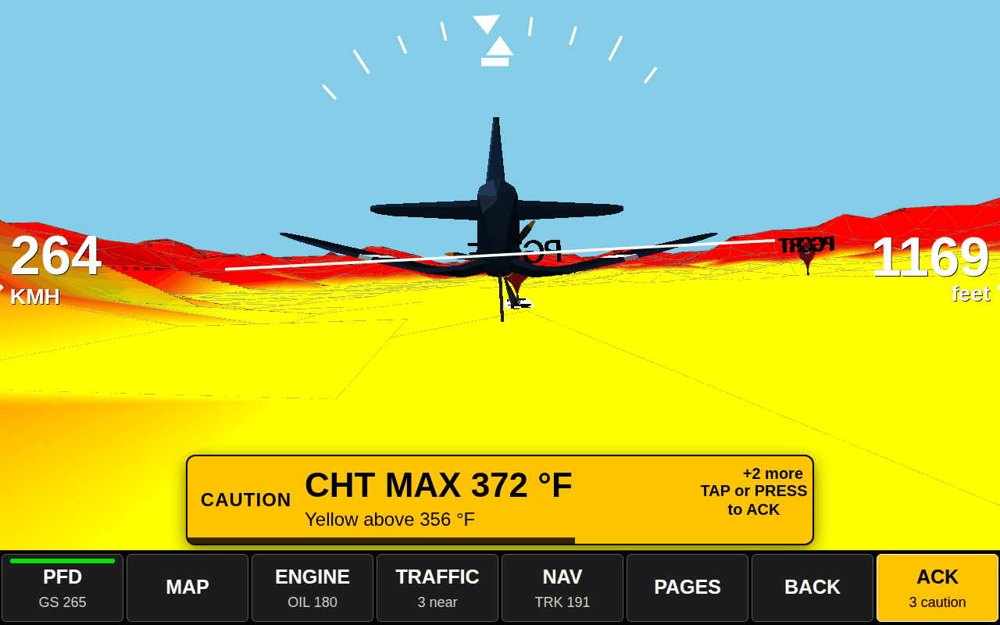 | 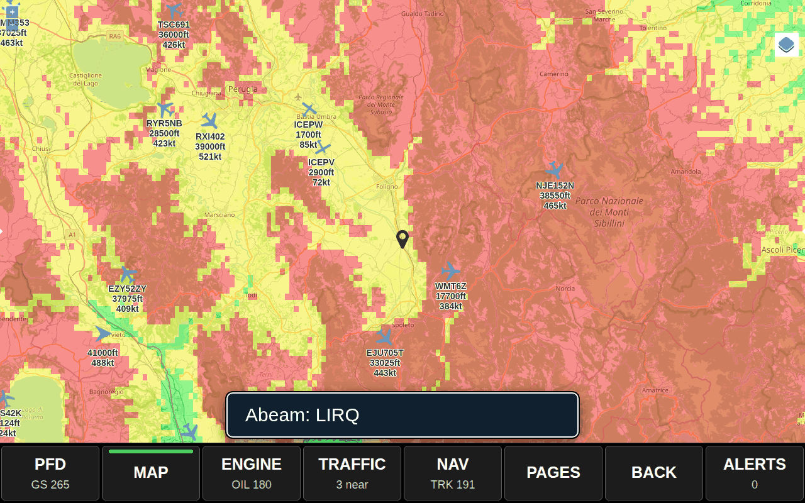 |

The popup text comes from a label, a value and a unit, not from `Alert.Title`, so that engine
values appear in the pilot's unit (A7). A short title stays readable at a glance: the subject and
value on one line, and what it means on the next.

### 3.4 After the popup closes

**1280×800:** the ALERTS key is the annunciator, as on Dynon. The strip below shows it idle, then
unacknowledged and acknowledged for each level. The bar never hides, so an active alert stays in
view on every plate.

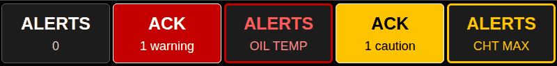

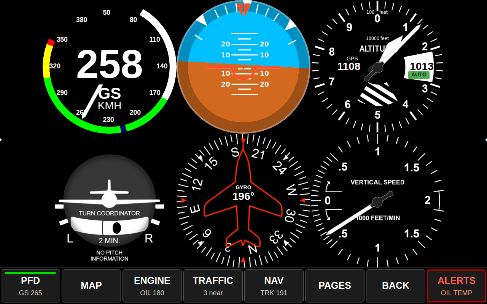

**480×480:** there is no room for a bar, so the ring flashes until acknowledged, and a chip above
the bottom handle names the worst active alert. Once acknowledged the ring goes off and the chip
stays. A solid ring for a 20-minute climb at yellow CHT would only teach the pilot to ignore it.

**Same rule on both:** the first touch of the alert target acknowledges, the next opens the list.

Use one CSS animation at 1 Hz for all flashing so that everything stays in phase. Animate
`opacity` only, so it stays on the compositor and costs nothing on the WebGL plates.

### 3.5 Several alerts at once

- One popup at a time.
- A WARNING replaces a lower-level popup at once. The interrupted popup returns afterwards with its
  remaining time.
- Same level: first in, first out, with a `+N more` badge.
- Events within 1 s from the same source collapse into one popup, showing the worst one with
  `+N more`. One acknowledgement covers them all, so an engine probe failure is not five taps.
- An ADVISORY waiting more than 30 s goes straight to the list.

Deferring ADVISORY popups during take-off and landing is worth doing later, with the speed test
that `main/hobbsmeter.go` already uses to detect a flight. Kanardia's engine-running condition on
oil pressure alarms is the same idea, and would stop nuisance alarms during engine start.

### 3.6 Sound

The daemon path (`aplay`) is the one that needs no touch on the screen, so it should be the primary
path. The browser path stays for tablets and other remote displays. If `audio.play()` is refused
by the autoplay policy, show `AUDIO OFF` on the annunciator instead of failing silently: a pilot
who believes the alerts are audible is worse off than one who knows they are not.

Sounds must not overlap (the `TODO` in `pushEvent()`): one player, highest level first.

### 3.7 Alert list

`#/alerts` shows active alerts first, then history, with the age of each (`+03:10`) and its state.
Selecting a row opens its source plate where there is one, such as `#/ems`. Rotating the knob moves
the selection, and `#/alerts` joins `navigationSortSquare` so that the round panel can reach it.

| 480×480 round | 1280×800 |
|---|---|
| 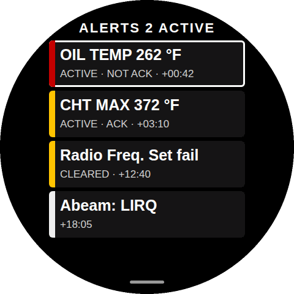 | 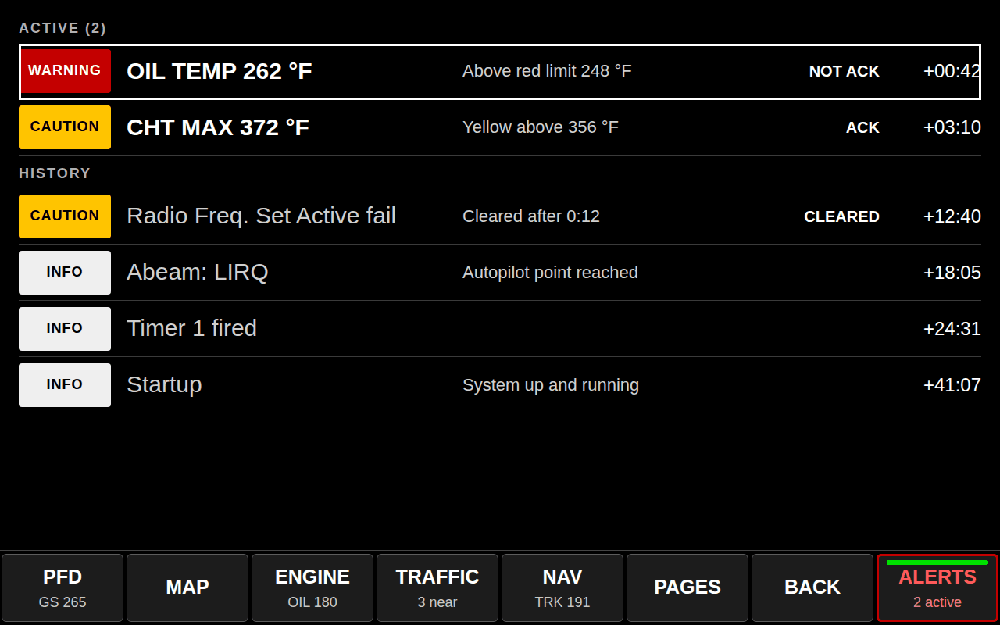 |

## 4. Navigation

### 4.1 Eight commands, same order everywhere

| Slot | Label | 1280×800 | Round | Sub-label at 1280×800 |
|---|---|---|---|---|
| 1 | PFD | `#/sixpack` | `#/attitude` | Ground speed |
| 2 | MAP | `#/map` | `#/map` | |
| 3 | ENGINE | `#/ems` | `#/emsegt` | Oil temperature |
| 4 | TRAFFIC | `#/radar` | `#/radar` | Targets nearby |
| 5 | NAV | `#/autopilot` | `#/hsi` | Track |
| 6 | PAGES | All pages | All pages | |
| 7 | BACK | Previous page | Previous page | |
| 8 | ALERTS | Acknowledge, then list | Acknowledge, then list | Worst active alert |

Slots 1 to 5 are configurable per display. Slots 6 to 8 are fixed, so that a pilot who moves
between aircraft finds them in the same place. A green lamp marks the current page, the same idea
as `.rb-button-switch-light`.

The east and west edge zones stay as next and previous page, so existing habits keep working.

### 4.2 1280×800: soft bar

Eight keys in a bar 96 px high along the bottom, always visible. Each hit area is the full
160×96 cell. The bar reserves its space, so plates reflow to 1280×704 and nothing sits beneath it.
The bottom edge lets a finger rest on the bezel in turbulence (AC 20-175 §2-10).

The soft bar replaces the old top and bottom bars and the north and south FABs:

| Old control | New place |
|---|---|
| TRAF NEAR, AL RM | TRAFFIC and ALERTS keys |
| GS, TRK | Sub-labels on PFD and NAV |
| MAX G, QNH | G METER and PFD pages |
| LEFT PNL, RIGHT PNL, full screen | Top row of PAGES |

PAGES lists every page of `navigationSortLandscape`, and the knob moves the selection.

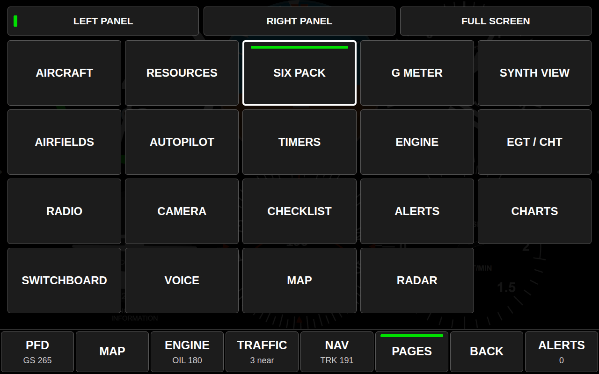

### 4.3 480×480: ring panel

A permanent bar would cost 20% of a small round display, or be too small to touch. So the panel
appears on demand and fills the circle: eight Ø110 px buttons at radius 168 px around a Ø190 px
hub, in the same order as the soft bar, clockwise from half past one. Rotating the knob clockwise
moves clockwise, which a grid cannot offer. The hub closes the panel, and it closes by itself after
6 s, which also returns the plate if the panel was opened by accident.

The panel opens from a handle at the bottom: a 180×84 px zone that reaches the screen edge, marked
by a thin line that stays visible (AC 20-175 §3-2), unlike today's fading FABs. Knob hold opens it
too. This reuses `.fabSouth`.

PAGES opens a three-row wheel because 20 pages will not fit as touch targets on this panel: the
upper and lower rows are themselves the previous and next targets, and the knob turns it.

| Ring panel | PAGES wheel |
|---|---|
| 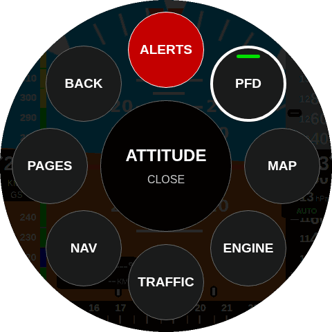 | 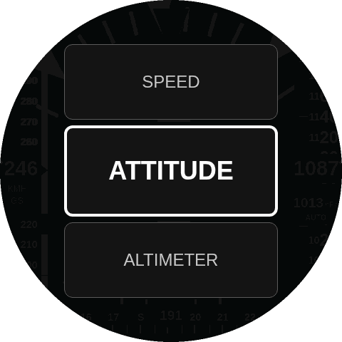 |

**The handle sits over real controls.** On `timers`, `radio`, `switchboard` and `autopilot`, controls
pass through that zone (running HMI). All four scroll, so on the round panel give
`.scrollable-content` 84 px of bottom padding, and every control can then scroll clear of it.

### 4.4 External keypad

Three levels of hardware, all optional, none needing a code change:

- **Touch only.** Everything works through the soft bar or the ring.
- **Current keypad: knob and three keys.** Mapping below.
- **Eight-key strip.** `F1`–`F8` map to slots 1–8. Mounted under the 1280×800 display, the keys line
  up with the soft bar labels, as on Dynon's shelf. Any USB macro pad will do; `F1` exists on both
  the Go and browser paths.

| Control | Normal | Popup on screen | Panel, PAGES or list open |
|---|---|---|---|
| Knob rotate | Unchanged: plate focus | Unchanged | Moves the selection |
| Knob press | Unchanged: plate TAP | **Acknowledge** | Opens the selection |
| Knob hold (500 ms) | Open the panel | Open the panel | Close |
| Key A | Home, unchanged | Unchanged | Unchanged |
| Key B | **BACK** (today `#/radar`) | Same | Close |
| Key C | **ALERTS** (today `#/airfields`) | Acknowledge | Same as normal |
| `F1`–`F8` | Slots 1–8 | Same | Same |

The press is captured only while a popup is on screen. Once it has closed, pressing the knob
returns to its plate function: otherwise a pilot working through a checklist would lose presses
to an alert acknowledged long ago, and would learn to press without looking.

Keys B and C change meaning for current users; see [Decision 4](#6-decisions-needed).

RB-08 voice commands arrive as `key` events through `PUT /remote`, so "acknowledge" needs only a
keyword mapping.

### 4.5 Touch target sizes

Sizes in millimetres. The physical panels are not recorded in this repository, so these are
assumptions; see [Decision 3](#6-decisions-needed). The reference is 15 mm, or 20 mm for critical use.

| Target | px | Round 2.8 in (6.75 px/mm) | 7 in (8.49) | 8 in (7.43) | 10.1 in (5.88) |
|---|---|---|---|---|---|
| Today's edge FAB | 48×120 | 7×18 | | | |
| Ring button | Ø110 | **16** | | | |
| Ring hub | Ø190 | **28** | | | |
| Handle | 180×84 | 27×**12** | | | |
| WARNING popup | full width × 164 / 800×132 | **24** high | **16** high | **18** high | **22** high |
| CAUTION popup | full width × 132 / 800×112 | **20** high | **13** high | **15** high | **19** high |
| Soft key | 160×96 | | 19×**11** | 22×**13** | 27×**16** |

Three targets can fall short of 15 mm:

- **The handle:** it is on the screen edge, so a finger can brace on the bezel, and the knob is an
  alternative.
- **The soft key on a 7 or 8 in panel:** it has the same bezel advantage, and `--bar` can be raised
  to 128 px on a 7 in panel to reach 15 mm, at the cost of more plate area.
- **The CAUTION popup on a 7 in panel:** it can grow to 132 px, the size of a WARNING, and stay
  distinct by colour and word.

Test on real panels with gloves before fixing these numbers.

## 5. Implementation

| Phase | Work | Files | Open findings closed | Effort |
|---|---|---|---|---|
| **0. Prerequisite** | Correct the `AlertsService` guard (done); add `#/alerts` to `navigationSortSquare`; fix the row in A5; guard the mapping against an array shorter than the enum | `js/main.js`, `settings/navigation.json`, `settings/alertsMapping.json`, `plates/js/alerts.js` | A1, A3, A4 (the display no longer falls back to info), A5 | S |
| **1. Popups** | Balloon and ring (done). Levels, queue, frame, chip annunciator, guards, display link alert. Acknowledgement is per display, held in memory. | `services/servicealerts.js`, new `css/alertspopup.css`, new `settings/alertsPolicy.json`, `index.html` | RB-HLR-ALR-230, and RB-HLR-ALR-190 for the visual half | M |
| **2. Alert state** | `Ident`, `Active`, `Acked`, label, value, unit; clear events; `POST /alerts/ack`; synchronised acknowledgement; replace the 5-minute interval with hysteresis; trim the list | `main/alerts.go`, `main/ems.go`, `main/gen_gdl90.go`, `main/managementinterface.go`, `requirements/` | A6, A7, A8, RB-HLR-ALR-160, RB-HLR-ALR-220 | M |
| **3. Alert list** | Active and history sections, age, row actions, knob | `plates/alerts.html`, `plates/js/alerts.js`, `css/alerts.css` | RB-HLR-ALR-250, RB-HLR-ALR-260 | S |
| **4. Navigation** | Actions in the `key` listener, soft bar, ring panel, PAGES, hold, retiring the old bars; the chip moves into the ALERTS key at 1280×800 | `services/servicekeypad.js`, `js/main.js`, `index.html`, `plates/js/bottom.js`, `settings/keypad.json`, `css/style.css` | N2, N3, N4, N5 | M |
| **5. New alert sources** | Terrain warnings and voice callouts through the same levels | Per `competitor-features.md` | | |

Alerts come before navigation because a silent, invisible failure is a safety gap and a slow page
change is not. At 1280×800 the chip stands in for the ALERTS key until phase 4.

### Severity moves out of the language rows

`web/settings/alertsPolicy.json`, keyed by event Id, one per installation. It is a separate file
because `alertsMapping.json` is unmarshalled as `map[string][]EventHolder`, so a top-level object
there would raise an unmarshal error.

```json
{
  "EVENT_TYPE_EMS_RULE_RED":    { "level": "WARNING",  "popupSeconds": 10, "repeatSeconds": 10 },
  "EVENT_TYPE_EMS_RULE_YELLOW": { "level": "CAUTION",  "popupSeconds": 10 },
  "EVENT_TYPE_TIMER":           { "level": "ADVISORY", "popupSeconds": 10 },
  "EVENT_TYPE_STARTUP_INFO":    { "level": "LOG" }
}
```

An event missing from the file is treated as WARNING, so that a new event cannot be silent. Like
the mapping file, this one changes what the pilot sees and belongs under configuration control
(`scmp.md`).

### The keypad needs one change

Add an `action` beside `href` in `directKey`. Soft keys dispatch `SOFT_1` to `SOFT_8` exactly as
`fabClick()` dispatches `DOM_CLICK_*`, so they use the per-display `directKeySquare` and
`directKeyLandscape` tables that already exist.

```json
"directKey": {
  "SOFT_1": { "href": "#/sixpack", "label": "PFD" },
  "SOFT_6": { "action": "PAGES", "label": "PAGES" },
  "SOFT_7": { "action": "BACK", "label": "BACK" },
  "SOFT_8": { "action": "ALERTS", "label": "ALERTS" },
  "F1": { "alias": "SOFT_1" },
  "B":  { "action": "BACK" },
  "C":  { "action": "ALERTS" }
}
```

Traps in `services/servicekeypad.js`:

- The per-display table is only read if the key is also in the base `directKey`, so every soft key
  needs a base entry.
- Do not add these functions to `keyToFunction()`: it calls `forEach` on every name in its list, and
  a `keypad.json` already edited on a unit without the new name would throw. `action` avoids this.
- Keep the alert check first in the `key` listener, before `directKey`, or a TAP will act on the
  plate instead of acknowledging.
- Bind both spellings of a key (`A` and `a`, see N6), and drop a repeat of the same key within
  100 ms if N7 proves true on hardware.

### Tests

Add `test/display/test_alerts.py`, local only like the other display tests, pushing events through
`/sim/push/alerts`:

- Each level shows the right popup, and closes on time without being touched.
- WARNING and CAUTION stay on the annunciator after closing. ADVISORY does not.
- Touch and key both acknowledge. Neither does in the first 500 ms.
- Knob press goes to the plate once the popup has closed.
- A WARNING pre-empts a CAUTION, and the CAUTION returns.
- The plate hash never changes on an alert.
- An unknown or negative event type is listed and does not break the queue (RB-HLR-ALR-260).
- Popup and ring stay inside the circle at 480×480, using `Display.controls()` geometry.

**Use an exact viewport.** `Display(window="480,480")` gave 500×337, and `"1280,800"` gave 1280×657,
because the window includes browser chrome. `Emulation.setDeviceMetricsOverride` gives the real
size, as `mockups.py` does. The same applies to `test_layout.py`, whose geometries are smaller than
their names say, so it does not reach the `innerHeight > 480` branch as its docstring expects.

### Requirements and safety

The alert function is the mitigation most of the FHA relies on, so this is not only UI work:

- Update the open-finding note on RB-HLR-ALR-230 with A1.
- Add requirements for level, popup duration, acknowledgement, the input guard and synchronisation,
  with `Covers:` tags on the new tests.
- Add a review of FHA-SYS-3: a popup covers instrument area for up to 10 s, and is a distraction by
  design. Assumption A1 (required instruments remain installed) supports this, but it needs saying.

## 6. Decisions needed

| # | Decision | Recommendation |
|---|---|---|
| 1 | **Does the 10 s limit close the popup, or end the alert?** | **Decided 2026-11-04:** every alert closes after 10 s, and keeping the status until the error has ended is tech debt TD1. The reason to come back to it: without it a red alert can vanish unread, and both Dynon and the FAA guidance keep the indication until the condition ends. |
| 2 | Are the levels in [3.1](#31-levels) right, in particular the downgrades of SDR and settings failures to CAUTION? | Review with the FHA. If in doubt keep WARNING for anything an FHA row relies on. |
| 3 | Which physical panels ship, in inches and shape? | Needed to fix `--bar` and the ring size. Sizes in 4.5 are assumptions. |
| 4 | May keys B and C change from `#/radar` and `#/airfields` to BACK and ALERTS? | Yes for new installs. It is only `keypad.json`, so existing units can keep their mapping. |
| 5 | Should `Audio_Enabled` default to on? | Yes where an audio output is fitted, since RB-HLR-ALR-190 cannot close otherwise. Requires the check that `aplay` reaches the aircraft's audio. |
| 6 | Should a WARNING's tone stop on acknowledgement or only when cleared? | On acknowledgement for today's events. AC 25.1322-1 keeps tones non-cancelable for time-critical alerts, such as a stall warning, and where continuous awareness is needed. None of today's events is of that kind, but terrain warnings will be, so make `repeatUntil` a policy field when they arrive. |

Out of scope: other geometries. 800×480, 1024×600 and portrait should inherit the soft bar scaled,
and need a check of their own. So does a square 480×480 panel, if one is ever fitted. The ring
works there as is.

## Sources

Read directly:

- Garmin G3X Touch Pilot's Guide 190-01754-00 Rev. Y, Annunciations & Alerts, hazard avoidance:
  <https://static.garmin.com/pumac/190-01754-00_y.pdf>
- Dynon SkyView HDX Pilot's User Guide Rev. Q, sections 3 and 12:
  <https://dynonavionics.com/includes/guides/skyview/SkyView_HDX_Pilots_Users_Guide-Rev_Q.pdf>
- Garmin GI 275 manual, Abnormal Operations:
  <https://www.manualslib.com/manual/1995533/Garmin-Gi-275.html?page=91>
- FAA AC 25.1322-1, Flightcrew Alerting:
  <https://www.faa.gov/documentLibrary/media/Advisory_Circular/AC_25.1322-1.pdf>
- FAA AC 23.1311-1C, Installation of Electronic Display in Part 23 Airplanes:
  <https://www.faa.gov/documentLibrary/media/Advisory_Circular/AC_23_1311-1C.pdf>
- FAA AC 20-175, Controls for Flight Deck Systems:
  <https://www.faa.gov/documentLibrary/media/Advisory_Circular/AC_20-175.pdf>

Search excerpts only; the pages themselves could not be opened, so check before relying on them:

- Avsar, Fischer and Rodden, *Target size guidelines for interactive displays on the flight deck*,
  DASC 2015: <https://eprints.nottingham.ac.uk/31399>
- MGL forum, alarm acknowledge: <https://mglavionics.co.za/phpBB3/viewtopic.php?p=963>, and firmware
  notes: <https://mglavionics.co.za/iEFISUpdates.htm>
- Kanardia Nesis III manual, third-party copy:
  <https://manualshive.com/en/manual/kanardia/nesis-iii/3362045?page=80>
