# Synthetic view: terrain rendering improvements

Status, 2026-11-22: **implemented** (uncommitted): P1 dome, P2 brown underside, P3 camera
clearance, and the owner's S4 choice: haze + terrain lit by a sun 315° relative to the heading at
15°, with **1024 PCF cast shadows** (section 13). Tested by `test/display/test_synthview_terrain.py`
(16/16) and on the bench Pi 5 GPU. The strong-colour variants of section 7 and S1–S3 remain
samples, not chosen.

The renders are real: the RB-01 synthetic view captured headless at 1280x800, with
[proposal-patch.js](synthview-terrain-rendering/proposal-patch.js) (sections 2–3) or
[colors-patch.js](synthview-terrain-rendering/colors-patch.js) (section 7) evaluated on the live
page. [mockups.py](synthview-terrain-rendering/mockups.py) reproduces every image.
Owner: xiaprojects.

Starting point (owner): below the terrain the view shows cyan instead of brown.

## 1. What the code does today

Checked in `web/RB-01/plates/js/synthview.js` (class `Rendering`), `web/RB-01/js/global.js`
and `web/settings/synthview.json`.

| # | Finding |
|---|---|
| F1 | The terrain is one finite mesh, the shared terrain window: 179 x 180 nodes, about 78 km of scene units each side, elevations −2…2050 m on the test flight. |
| F2 | Everything that is not mesh is `scene.background`, a flat `skyColor` (0.52, 0.8, 0.91): the cyan. That includes the ground beyond the window edge and everything under the surface. There is no ground plane, no skirt and no sky gradient. |
| F3 | The terrain material is `MeshPhongMaterial` with `side: DoubleSide`. From under the surface the pilot sees the top colours, mirrored (red/green on the "ceiling"), with cyan below. |
| F4 | The chase camera sits 2.5 cells (about 1.1 km of scene units) behind the aircraft **at the aircraft's own altitude**. It goes under the surface when the ground behind is higher than the aircraft: on the ground, on short final, climbing out of a valley. The aircraft itself is clear, yet the pilot sees F3. |
| F5 | Colours are `globalTerrainColor()`: pure `#00ff00` clear, `#ffff00` within 200 m (`TERRAIN_CAUTION_METERS`), `#ff0000` above the aircraft, `#0000ff` at or below 0 m. These are saturated alarm colours used as the background of the whole scene; relief is hard to read. |
| F6 | Colours are recomputed in JavaScript for all ~32,000 vertices each time the altitude moves 150 m (`animate()`), so the caution band jumps in 150 m steps. |
| F7 | Phong with `shininess: 50` puts a specular glare on slopes facing the light; the light sits at (2000, 2000, 0), east and level with mid-terrain. A grey `EdgesGeometry` wireframe at 50 % opacity covers the mesh and becomes noise towards the horizon. |
| F8 | No haze: the window edge is a hard line against the sky at altitude (blue sea strip at the top of the "high" render). |
| F9 | The renderer is created with `antialias` commented out. |

## 2. Proposal

| # | Change | Fixes |
|---|---|---|
| P1 | **Sky/ground dome** that follows the camera: blue above the horizon, haze at the horizon, brown below it, the attitude-indicator convention. Replaces the flat `skyColor`. Anywhere the terrain does not cover is brown below the horizon, not cyan. | F2 |
| P2 | **Under the surface is brown**: terrain front face only, plus the same geometry drawn back-face in solid brown. A camera inside a hill sees brown, never sky. | F2, F3 |
| P3 | **Camera terrain clearance**: the chase camera stays at least 60 m above the ground under it and looks at the aircraft. In the product, read the height from the grid (bilinear), not with a raycast. | F4 |
| P4 | **Natural terrain colours** by elevation (olive → tan → brown → rock → snow, water dark blue). Caution yellow and warning red stay, on the same `globalTerrainColor()` rule, blended over the natural colour, so the TAWS meaning does not change. The map keeps its colours. | F5 |
| P5 | **Haze**: `THREE.Fog` in the horizon colour, distances derived from the window size, so the window edge melts into the horizon. | F8 |
| P6 | **Lighting**: `MeshLambertMaterial` (cheaper than Phong, no glare), sun from the north-west and high (cartographic hill shading), wireframe at 10 %. | F7 |
| P7 | **Colours in the shader**: elevation as a vertex attribute and the aircraft altitude as a uniform, so the caution band moves continuously and the 150 m JavaScript recolour disappears. | F6 |

### Renders (left today, right proposal)

**Camera under the surface** (aircraft at 900 ft, below the terrain data; P3 switched off to
show P2 alone). Today: mirrored red "ceiling" over a cyan "ground". Proposal: brown.

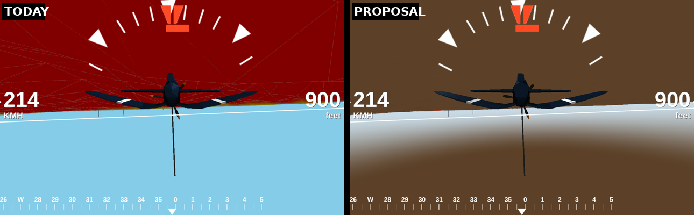

**Ground roll / short final** (1720 ft, terrain behind the aircraft is higher). Today the chase
camera is inside the hill: the aircraft is not visible. Proposal: P3 lifts the camera; the
terrain at the aircraft's height is red, as it should be.

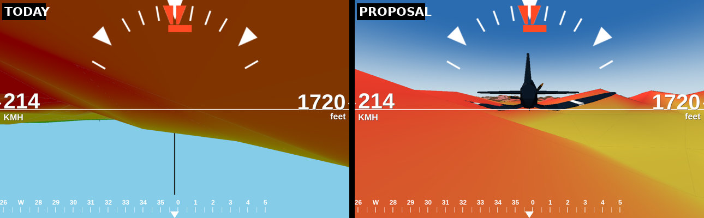

**Cruise** (2592 ft, ~280 m above the hills, so the caution tint is correct). Relief is readable
under the tint; sky gradient and haze give depth.

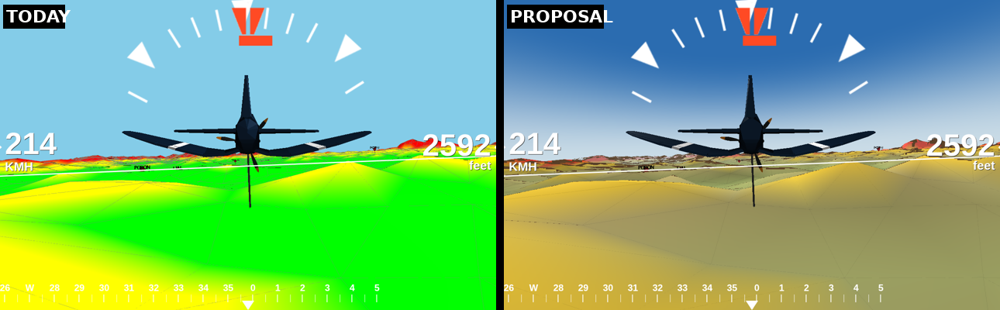

**High** (11,000 ft). Today the window edge and a blue strip of sea sit under the sky. Proposal:
the edge fades into the haze, ridges are shaded.

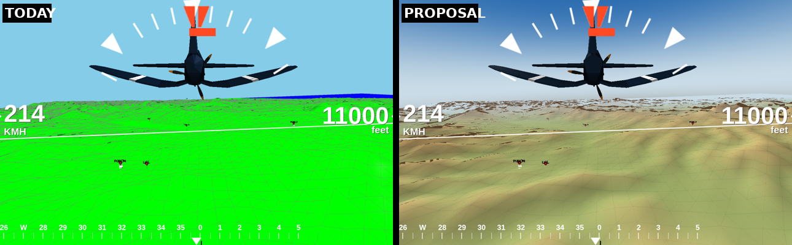

**40° bank**: the dome rolls with the camera, so the gradient stays aligned with the horizon.

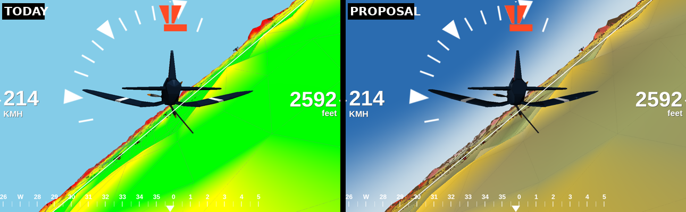

## 3. Implementation plan

All in `web/RB-01/plates/js/synthview.js` unless noted; `synthview.json` is CRLF, and so is the
RB-01 JS.

1. **P1 + P2** (the owner's point, smallest change). `Rendering`: add the dome
   (`ShaderMaterial`, `BackSide`, `depthTest/depthWrite: false`, `renderOrder` first, radius
   below `camera.far`), moved to the camera position before each render. `loadDEM`: front face
   only, add the brown back-face child mesh. New settings `skyColor` (zenith), `horizonColor`,
   `groundColor`; old `skyColor` keeps working as zenith.
2. **P3**. `cameraFollowItem`: after placing the camera, `y = max(y, groundAt(x, z) + 60)` and
   `lookAt` the aircraft; `groundAt` reads `terrainData` bilinearly via `TerrainManager`.
   Setting `cameraClearanceMeters`, default 60.
3. **P5 + P6**. Fog from the window size; Lambert; light position; wireframe opacity.
4. **P4 + P7** together. Vertex attribute `elevation`, uniform `altitude`, palette and the two
   TAWS thresholds as uniforms; `onBeforeCompile` on `MeshLambertMaterial` keeps fog and
   lights. The palette comes from `synthview.json`; `terrainColorRed/Yellow/Green/Sea`, which
   no code reads today, become the tint colours.
5. **Tests** (`test/display/`): a synthview pose test. Camera underground: no `skyColor` pixels
   below the horizon line. Cruise at caution height: yellow-tinted pixels present. Ground pose:
   the aircraft model is visible.
6. **Hardware check** on the RB-01 (Pi): frame time before/after. Expected equal or better
   (Lambert < Phong, no 32k-vertex JS loop); the dome is about 3,000 triangles.
7. Decide whether `web/plates/js/synthview.js` (Stratux UI copy) gets the same changes.

## 4. Further ideas, not in this plan

- **Flight path marker** (velocity vector) drawn in the 3D view: the standard SVT cue to see
  whether the aircraft clears the ridge ahead.
- **First-person view** option next to the chase view: no camera-in-terrain problem at all,
  and the terrain lines up with the attitude indicator.
- **Vertical exaggeration**: the scene is about 2× compressed horizontally (78 km of scene
  for ~145–200 km of window), so relief is drawn about 2× too tall. A setting, or true scale.
- **Antialiasing** (F9): `antialias: true` or FXAA, if the Pi has the headroom (step 6).
- Water: lakes are flat in the data, so they could be drawn as water by flatness, not only
  at ≤ 0 m.

## 5. Questions for the owner

| # | Question | Answer |
|---|---|---|
| Q1 | Natural colours with caution/warning tint (P4), or keep the green/yellow/red scene? | Keep strong colours, readable on a poor display in sunlight: section 7. |
| Q2 | Caution tint strength? | Superseded by Q1. |
| Q3 | Camera clearance 60 m, or a different margin? | 60 m, setting `cameraClearanceMeters`. |
| Q4 | Also port to the Stratux-UI copy, `web/plates/js/synthview.js`? | Open. |
| Q5 | Which colour variant of section 7: A, B or C? | Open. |
| Q6 | Beyond the window edge, at altitude, the sky colour still shows below the horizon (F8). Brown there: dome (P1), or a flat brown ground plane under the window? | Dome, sky and ground, without haze. |

## 6. Implemented: P1 without haze, P2 and P3

- `Rendering.setBackgroundColor(skyColor, groundColor)`: a sphere (`ShaderMaterial`,
  `BackSide`, no depth test or write, `renderOrder` −1000, never culled, radius half of
  `camera.far`) re-centred on the camera in `onBeforeRender`. Sky colour (`skyColor`, unchanged)
  above the eye-level horizon, `terrainUndersideColor` below it, hard edge, no fog. Its horizon
  lines up with the attitude horizon line. `scene.background` stays as a fallback.

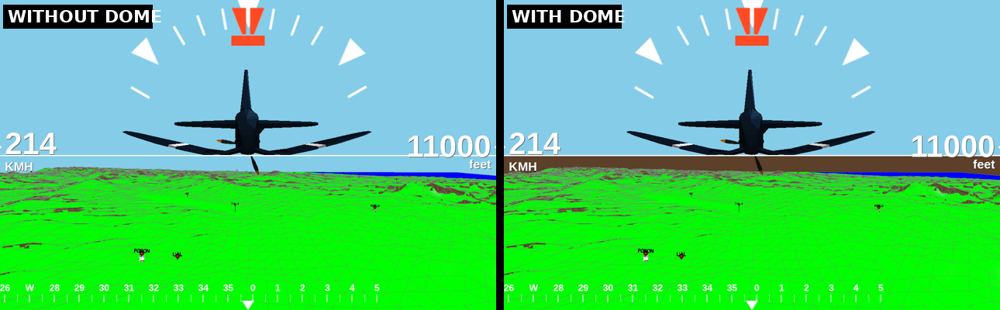

- `generateMaterial`: `side: FrontSide`. `loadDEM`: a child mesh on the same geometry,
  `MeshBasicMaterial`, `BackSide`, colour `terrainUndersideColor` (synthview.json, default
  0.36/0.25/0.16 brown). Disposed with the terrain by `disposeDEM`.
- `Rendering.groundAt(x, z)`: the highest of the four grid nodes around a scene point, so a
  camera held there is never inside the mesh; null off the window. `cameraFollowItem` keeps the
  camera `cameraClearanceMeters` (default 60) above it, before `controls.update()`, so the
  camera looks down at the aircraft. The orbit mode (`remote.reset`) is not affected.
- In the ground pose the camera is now at 659 m over a 599 m node, where it used to be at
  524 m, inside the hill.

## 7. Proposal: strong colours, no smooth shading

Owner's requirement: the scene must stay readable on a poor display in sunlight, so strong
saturated colours, not soft shading. All three variants keep the `globalTerrainColor()` meaning
(water ≤ 0 m, red above the aircraft, yellow within 200 m below it, green otherwise) and are
drawn in a fragment shader, so:

- the edges between colours are **hard** (classification per pixel), not the vertex gradients
  of today, where the yellow and red bands smear into the green;
- the colours are **unlit**: every slope keeps full saturation, no dark or glaring faces;
- relief comes from **thin dark contour lines every 100 m**, faded out where they would
  crowd, replacing the grey wireframe;
- the altitude is a uniform: the bands move continuously, not in 150 m steps (P7 for free).

| Variant | Adds |
|---|---|
| A crisp | today's pure colours (#00ff00, #ffff00, #ff0000, #0000ff) |
| B + borders | a black outline on the caution and warning heights, the boundary visible even when the colours wash out; green darkened to #00b400 so yellow and red pop and white digits read on it; sky deepened to #1f5fc4 for contrast with the white instruments |
| C + hatch | B, and the red area hatched in black diagonal stripes: terrain above the aircraft stays recognisable without colour (washed-out display, red/green colour-blind pilots, about 8 % of men) |

Each grid: today with P2+P3 top left, A top right, B bottom left, C bottom right.

**Rolling at 1720 ft**: the terrain at and above the aircraft.

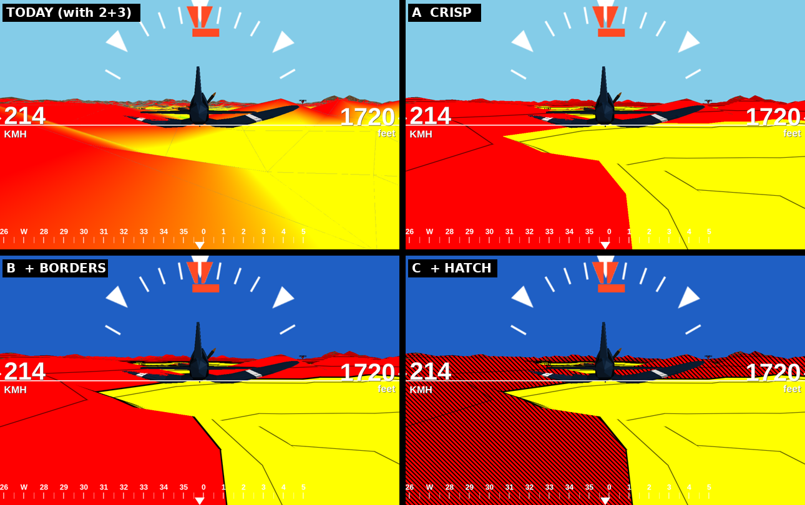

**Cruise at 2592 ft**, about 280 m over the hills.

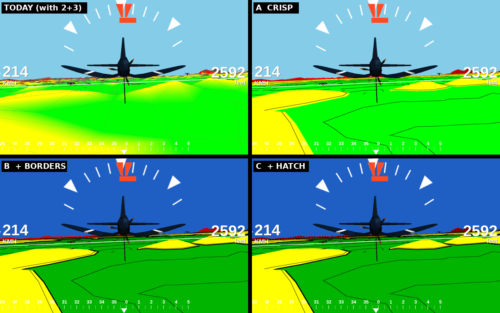

**40° bank**

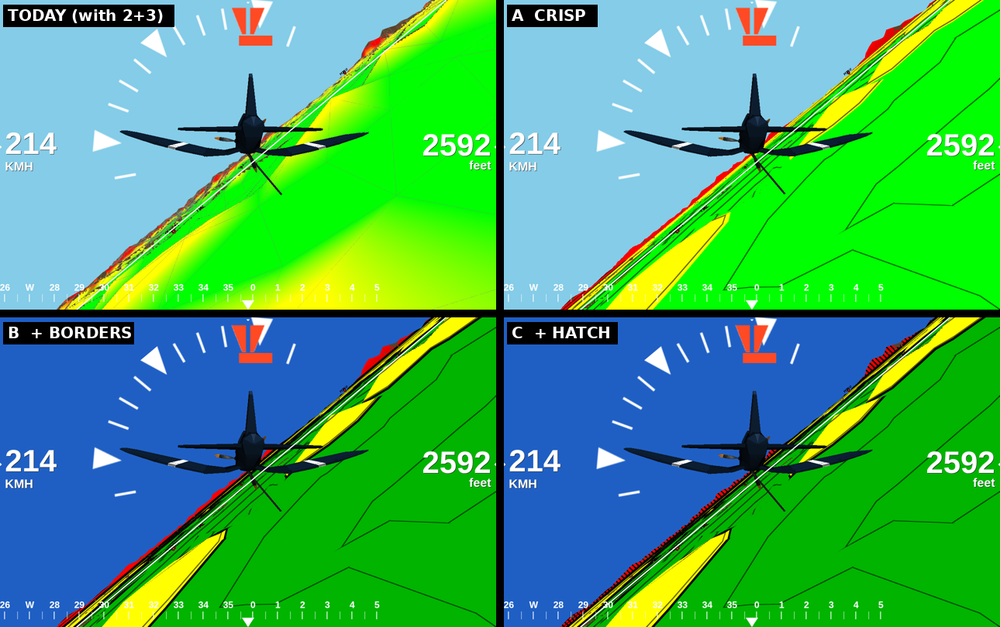

**11,000 ft**: contours carry the relief where everything is green.

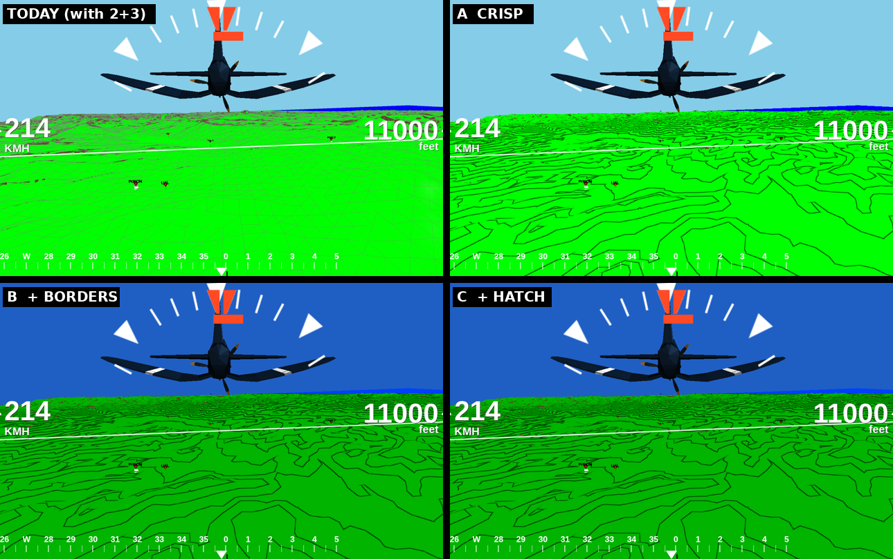

Implementation once a variant is chosen: replace the `MeshPhongMaterial` and the colour array
with the `ShaderMaterial` of `colors-patch.js`, colours and contour interval from
`synthview.json` (`terrainColorRed/Yellow/Green/Sea`, unused today, become them), remove the
`EdgesGeometry` wireframe and the 150 m recolour in `animate()`. Check frame time on the Pi
(expected lower: no lighting, no 32k-vertex JS loop). The map keeps its own colours.

## 8. Cost of haze and shadows on the RB-01 (measured 2026-11-22)

Bench RB-01: Raspberry Pi 5 (2 GB), kiosk Chromium 156 on Wayland (ANGLE/GLES, WebGL 2),
canvas 1280x720, three.js r136, on the ground near Perugia with a live GPS fix, the working-copy
`synthview.js` (dome, brown underside, clearance). Each effect was switched on in the live page
by [bench.py](synthview-terrain-rendering/bench.py); raw numbers in
[bench-2026-11-22.json](synthview-terrain-rendering/bench-2026-11-22.json). CPU is % of one core
(GPU process + renderer of Chromium); V3D is the render queue busy time from `gpu_stats`; frame
is one render + `gl.finish()`, median of 40.

| Configuration | Frame ms | 10 Hz: Chromium CPU | 10 Hz: V3D | 60 fps: Chromium CPU | 60 fps: V3D |
|---|---|---|---|---|---|
| Today (Phong, wireframe, dome) | 3.6–4.5 | 19–20 % | 6–7 % | 59–66 % | 26 % |
| + haze (fog) | 3.5 | 20 % | 8 % | 65 % | 26 % |
| Smooth hill shading (Lambert) | 4.5 | 22 % | 5 % | 70 % | 15 % |
| + cast shadows (2048, PCF soft) | 8.4 | 29 % | 16 % | 125 % | 77 % |
| + haze + shadows | 8.5 | 31 % | 16 % | 126 % | 78 % |
| Unlit strong colours (variant B) | 4.5 | 22 % | 5 % | 70 % | 15 % |

- **Haze is free**: within the run-to-run noise (±0.5 ms, a few % CPU).
- **Cast shadows double the frame** (+4 ms, +3 ms of it on the CPU) and triple the GPU: at 10 Hz
  +9 points of Chromium CPU and V3D 6 → 16 %; at the display rate V3D 26 → 77 % with the clock
  already at 1150 MHz, so no headroom left, and +2 °C. Shadows also need lit materials, which
  darken the strong colours the owner wants for sunlight.
- Hill shading (Lambert) and the unlit strong-colour shader cost the same as today; the
  shader does less GPU work than today's Phong.
- All 60 fps runs held 62 fps; the synthetic view renders on situation updates, so in flight
  the 10 Hz columns are the real load.
- **Bigger than any effect: the scene grows.** 218k triangles / 137 draw calls just after a
  reload, 345k / 476 in a page up 32 min, where the frame cost 10.9 ms instead of 3.6. Scene
  children grew by about 4 a minute (Group + 2 cylinders + text label each, i.e. traffic items)
  with only 2 live traffic targets, and GPU geometries 114 → 210 in 4 min. Probably traffic
  items not fully removed (`cleanupOldTraffic` removes one item per tick and never removes
  `referenceThreshold`); to be confirmed in a separate investigation.

## 9. Sample: haze and hill shading

Owner's request after section 8. Both effects on top of the implemented dome, underside and
clearance, rendered by [haze-shading-patch.js](synthview-terrain-rendering/haze-shading-patch.js)
(`VARIANT=S1` or `S2` in `mockups.py`). Each image: today, S1, S2.

- **Haze**: `THREE.Fog`, colour #c9dbe6, 8–30 km of scene units; the dome blends sky and ground
  into the same haze at the horizon, otherwise a hard brown band would sit between the faded
  terrain and the sky. Cost: nothing measurable (section 8).
- **Hill shading**: sun from the north-west about 30° up (low sun = readable relief), ambient
  0.4 + sun 0.75, capped at 1 so lit slopes keep the full colour. S1 uses
  `MeshLambertMaterial` on today's vertex colours (wireframe at 12 %); S2 does the same light
  in the variant B shader, with the crisp bands, contours and black caution/warning borders.
  Cost: same as today's Phong (section 8).
- Trade-off seen in the renders: shading is a darkening. Slopes facing away from the sun and
  flat ground lose up to 55 % of their brightness: yellow becomes olive, red becomes dark red
  (ground pose). That works against the sunlight requirement of section 7; the relief gain is
  largest at altitude (11,000 ft), smallest near the ground, where the warning colours matter
  most. A weaker shading (ambient 0.6) keeps the colours but the relief almost disappears
  (first attempt, not kept).

**Cruise at 2592 ft**

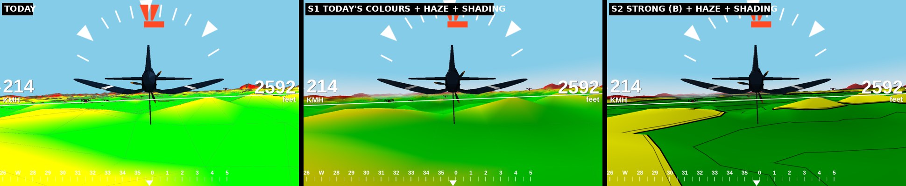

**Rolling at 1720 ft**

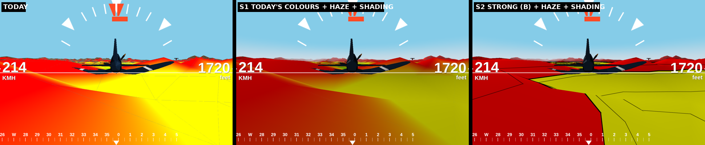

**11,000 ft**

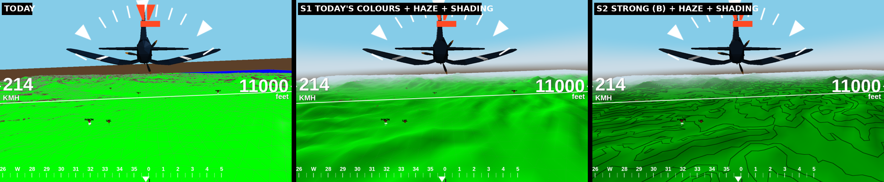

**40° bank**

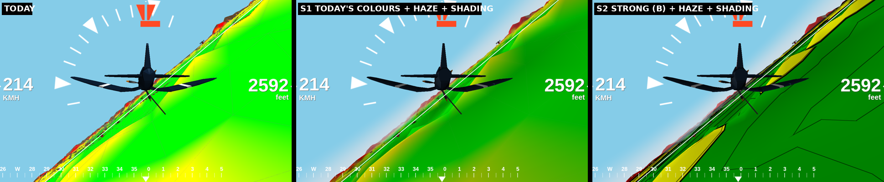

## 10. Design S3: sun relative to the heading

Owner's request: the light not fixed from the north-west but at **315° relative to the heading
(front left) and 60° above the horizon**. S3 is S2 (strong colours, contours, borders, haze)
with that sun: `haze-shading-patch.js`, `VARIANT=S3`. The sun direction is recomputed on every
frame from `GPSTrueCourse` (the heading the camera follows):

    az = heading + 315°,  el = 60°
    sun = (cos el · sin az,  sin el,  −cos el · cos az)      north −Z, east +X

The directional light that lights the aircraft model follows the same direction. Shading:
`0.45 + 0.75 · max(n·sun, 0)`, capped at 1, as in S2. Same cost as S2 (one uniform per frame).

What the renders show (left S2, sun fixed from 315° true at 30°; right S3):

- **Same look on every heading.** The relief is always lit from the front left, as on a
  shaded-relief chart, whichever way the aircraft points. With a fixed sun the shading changes
  as the aircraft turns; southbound it lights the slopes from behind.
- **Strong colours kept.** At 60° a flat surface gets n·sun = 0.87, so 1.10, capped at 1: flat
  ground and gentle slopes stay at full colour (ground pose: pure red and yellow in S3, dark red
  and olive in S2). Only steep slopes facing away from the sun darken. That suits the sunlight
  requirement of section 7.
- **Weaker relief.** For the same reason the relief is subtler than with a 30° sun, mostly
  visible on steep ground (11,000 ft). The contour lines carry most of the relief in S3.
- The northbound poses look almost the same in S2 and S3 (heading 358° puts the S3 sun at
  313°), except for the elevation.

**Southbound, cruise**

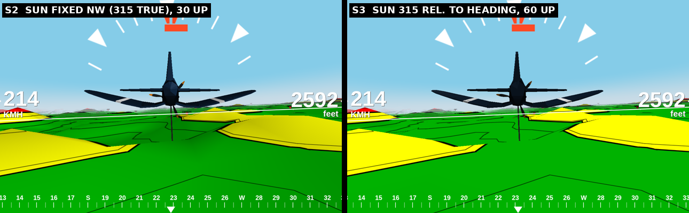

**Southbound, 11,000 ft**

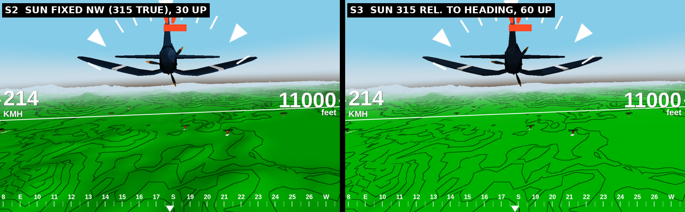

**Rolling at 1720 ft**

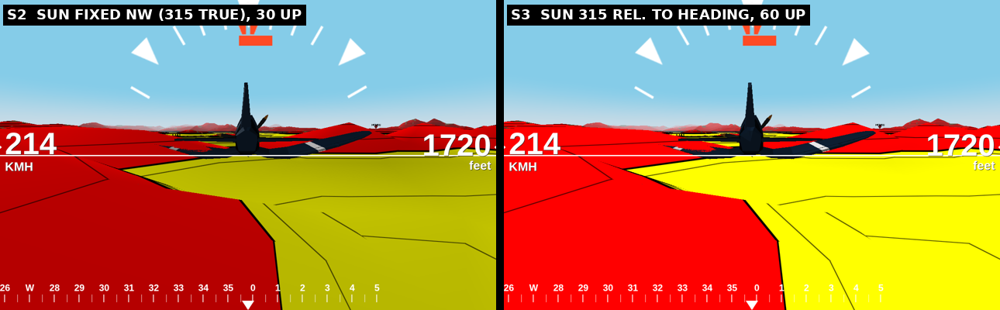

**Northbound, 11,000 ft**

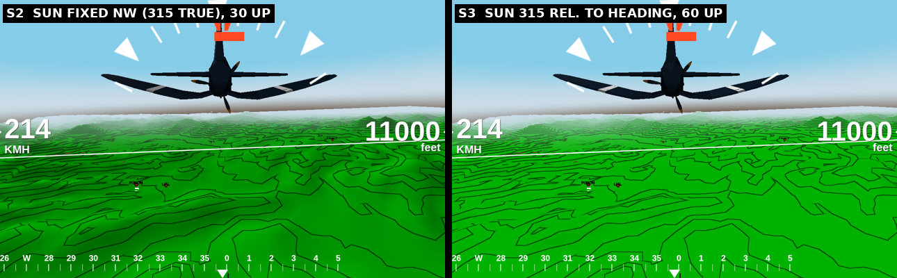

**Northbound, cruise**

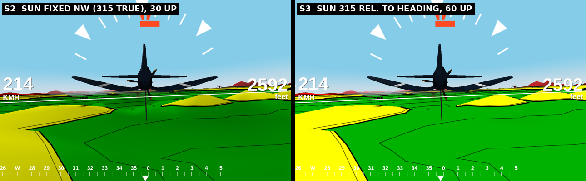

## 11. Design S4: today's design + haze + shading, low sun relative to the heading

Owner's request: today's design (smooth red/yellow/green vertex colours, wireframe, dome) with
haze and shadow, the light **15° above the horizon at 315° relative to the heading**.
[s4-patch.js](synthview-terrain-rendering/s4-patch.js); `RB_SHADOWS=1` in `mockups.py` adds real
cast shadows from the same sun. Each image: today, S4 (hill shading), S4 + cast shadows.

- Sun: `az = heading + 315°`, `el = 15°`, recomputed each frame from `GPSTrueCourse`; the
  directional light follows the camera target, so it also lights the aircraft model.
- `MeshLambertMaterial` on today's vertex colours (no Phong glare), wireframe unchanged.
  With a sun this low a flat surface gets only sin 15° = 0.26 of the direct light, so ambient
  is raised to 0.6 and the sun to 0.9: flat ground at about 0.83, slopes facing away down to
  0.6, slopes facing the sun saturate.
- Haze as in section 9 (fog #c9dbe6, 8–30 km, dome blended at the horizon).
- Cast shadows: 2048 PCF soft shadow map over ±16 km around the camera target, terrain casts
  and receives, the aircraft model does not cast (its symbol size would throw a huge shadow).

What the renders show:

- **Strongest relief of all designs**: the low sun picks out every valley and ridge, best at
  11,000 ft and southbound.
- **Colours darker**: flat ground at about 83 %, and slopes facing away at 60 %. Yellow turns
  olive and red turns dark red near the ground (ground pose). This is the opposite of S3.
- **Cast shadows add little**: at this terrain scale a 300 m ridge under a 15° sun throws a
  shadow about 1 km long, and the slopes that would be in shadow already face away from the
  sun, so the hill shading has darkened them. The visible difference is small (a darker band
  behind the ridge in cruise), for about +4 ms per frame and three times the GPU work (section 8).

**Southbound, 11,000 ft**

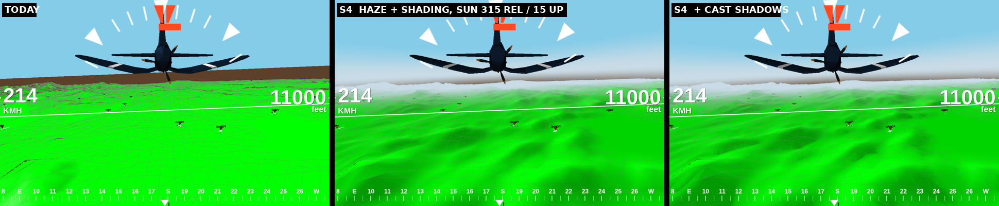

**Northbound, 11,000 ft**

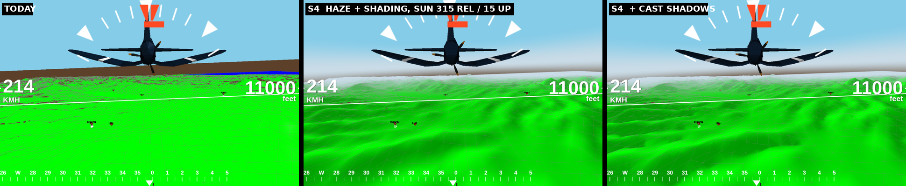

**Cruise**

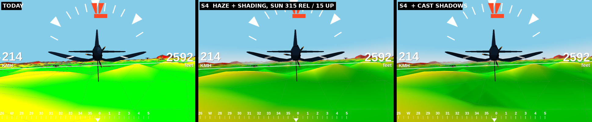

**Southbound, cruise**

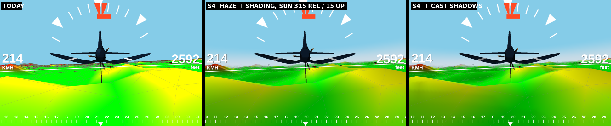

**Rolling at 1720 ft**

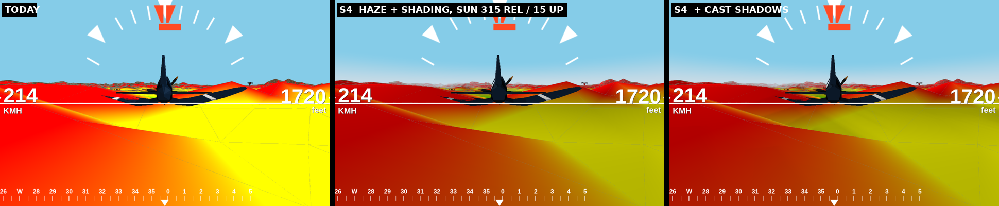

## 12. Cost of cast shadows in S4 (measured 2026-11-22)

Same bench and method as section 8, S4 loaded in the live page, cast shadows switched on and
off; [bench-shadows.py](synthview-terrain-rendering/bench-shadows.py), raw numbers in
[bench-shadows-2026-11-22.json](synthview-terrain-rendering/bench-shadows-2026-11-22.json). Scene
268k triangles, 213 draw calls. Chromium CPU = GPU process + renderer, % of one core; system =
all 4 cores; V3D = render queue busy.

| S4 configuration | Frame ms | JS ms | 10 Hz: Chromium CPU | 10 Hz: system | 10 Hz: V3D | 60 fps: Chromium CPU | 60 fps: V3D |
|---|---|---|---|---|---|---|---|
| No cast shadows (mean of 2 runs) | 5.0 | 4.3 | 21 % | 9.7 % | 5.3 % | 79 % | 17.5 % (500 MHz) |
| Cast shadows 2048, PCF soft | 7.0 | 5.7 | 27 % | 11.4 % | 12.0 % | 91 % | 52.5 % (1150 MHz) |
| Cast shadows 1024, PCF | 5.6 | 5.1 | 26 % | 11.2 % | 9.7 % | 85 % | 41.0 % (1150 MHz) |

- **CPU**: about +1–1.4 ms of JavaScript per frame (three.js draws the terrain a second time,
  into the shadow map): at 10 Hz +5–6 points of one core, +1.5–2 points of the whole Pi.
- **GPU**: 2048 soft +2 ms per frame, V3D 2.3× at 10 Hz (5 → 12 %) and 3× at 60 fps
  (17 → 52 %), with the V3D clock pushed from 500 to 1150 MHz. 1024 hard: +0.6 ms, V3D 1.8×.
- About half the section 8 cost (+4 ms there), because in S4 only the terrain casts; in
  section 8 every mesh (aircraft, traffic, labels, tubes) went through the shadow pass.
- +1 °C at the display rate. All runs held 62 fps.
- What it buys at this terrain scale is small (section 11).

## 13. Implemented: S4 with haze and 1024 cast shadows

Owner's choice after section 12: haze and cast shadows, map 1024 (PCF, hard edges), on S4
(today's colours, sun 315° relative to the heading at 15°).

- `Rendering.configureLighting(setup)` (called from `engageContext`): ambient and sun intensity,
  shadow map on/off, `PCFShadowMap`, map size, bias −0.0008, normal bias 20.
- `Rendering.fitToTerrain(width)` (called from `loadDEM`): `THREE.Fog` from `haze.start` to
  `haze.end` of the window half width; the shadow box ±`shadows.range` of it. Fractions, so they
  follow whatever grid `elevationUrl` serves.
- `Rendering.updateSun(heading)` (called by `animate()` before each render): the sun over the
  camera target at `heading + relativeAzimuth`, `elevation` up; the shadow box follows it.
- Terrain material `MeshLambertMaterial` (was Phong, `shininess` 50: no glare, cheaper).
  Only the terrain casts and receives shadows. Wireframe and colours unchanged.
- The dome blends sky and ground into the haze colour at the horizon when haze is on (hard
  horizon when off). A reversed `smoothstep` edge pair, undefined in GLSL, was avoided.
- `synthview.json` (defaults in `SYNTHVIEW_HAZE`, `SYNTHVIEW_SUN`, `SYNTHVIEW_SHADOWS` when a key
  is missing):

      "haze":    { "enabled": true, "color": {"r": 0.79, "g": 0.86, "b": 0.9}, "start": 0.2, "end": 0.77 },
      "sun":     { "relativeAzimuth": 315, "elevation": 15, "intensity": 0.9, "ambient": 0.6 },
      "shadows": { "enabled": true, "mapSize": 1024, "range": 0.4 }

- Test: fog fractions, 1024 PCF map created, only the terrain casting, Lambert, sun at
  315°/15° relative at headings 358 and 178, plus the earlier checks: 16/16.
- Bench Pi 5, real GPU: the working-copy `synthview.js` and `synthview.json` were served to the
  kiosk page by CDP request interception (no file written on the device), then the page was
  reloaded on its own files. No shader warning or JS error; shadow map 1024, fog on, sun 15°.
  At the app's real cadence (on the ground, 30 s each): Chromium CPU 12.2 → 13.0 % of one core,
  V3D 3.0 → 3.8 %. The bench still serves the previous version; deploy to see it there.

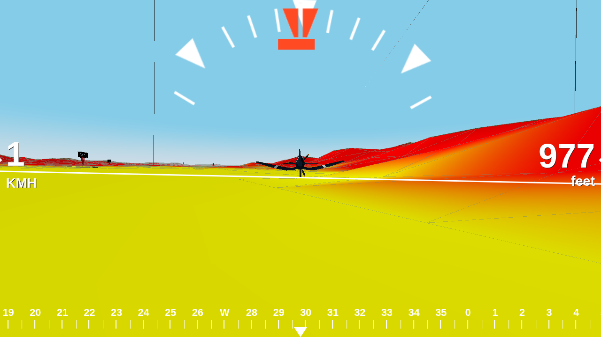
